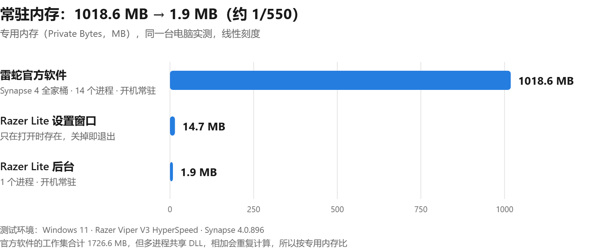
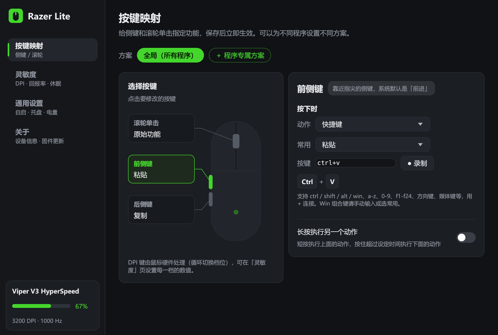
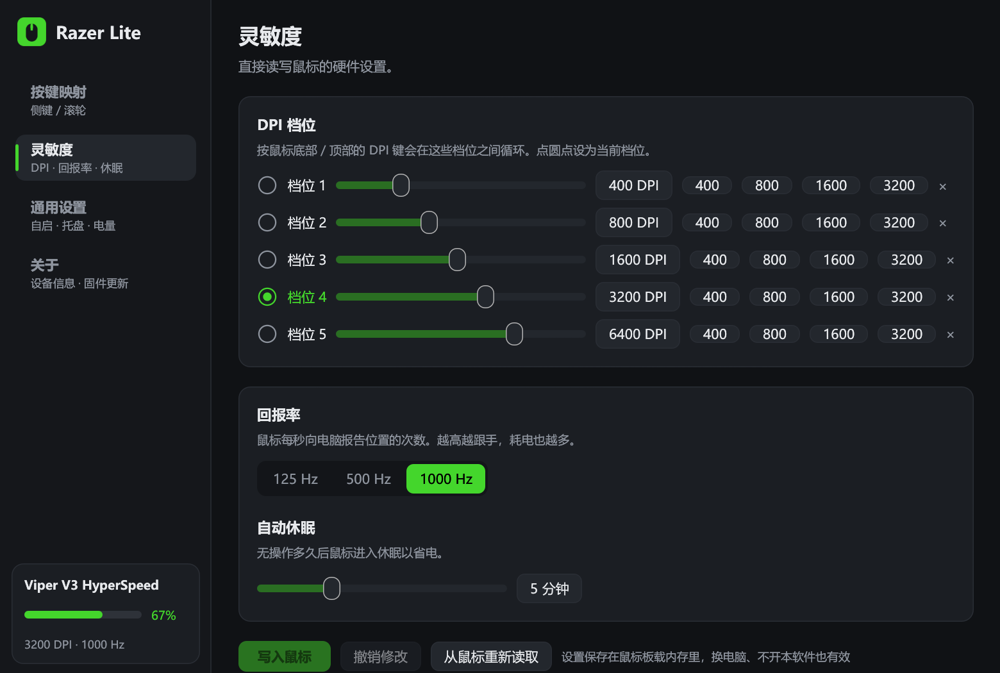

<div align="center">


# Razer Lite

**不装 Razer Synapse，也能用雷蛇鼠标的基础功能**


</div>

> [!WARNING]
> **这是个 AI slop。** 一句话让 AI 生成的，个人自用。与 Razer 官方无关。

## 内存占用

<picture>
  <source media="(prefers-color-scheme: dark)" srcset="docs/memory-dark.png">
  
</picture>

## 截图

<p align="center">
  
  
</p>

## 能干什么

- **侧键 / 滚轮映射**：快捷键（可录制）、输入文字、打开程序、DPI 离合，单击和长按分开设，还能按前台程序切换方案
- **硬件设置**：DPI 档位、回报率、休眠时间，直接写进鼠标板载内存
- **日常**：托盘电量、低电量提醒、开机静默自启
- **固件更新**：下载雷蛇官方更新程序，校验签名后运行
- **不要雷蛇驱动**：用 Windows 自带的 HID 驱动和鼠标通信

只在 Razer Viper V3 HyperSpeed 上测过。

## 安装

到 [Releases](https://github.com/yuukana1/razer-lite/releases/latest) 下载 zip，解压后运行：

```powershell
powershell -ExecutionPolicy Bypass -File install.ps1   # 加 -Uninstall 卸载
```

exe 没有代码签名，第一次运行 Windows 可能提示“已保护你的电脑”，点「更多信息 → 仍要运行」。

从源码编译：`cargo build --release`，再运行同一个 `install.ps1`。

HID 协议参考 [OpenRazer](https://github.com/openrazer/openrazer)。
